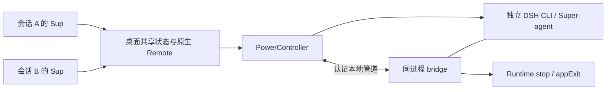

# 设计说明

## 资源属于进程，开关属于全局

Sup 的目标是让“是否需要 Super-agent 值守”有一个明确、可见的选择。它不控制模型本身的内存，也不是系统内存优化器。启用时仍然正常承担 Super-agent 的运行成本；不需要时退出独立后台进程，释放该进程的运行资源。

一个共享后台不能同时满足“会话 A 开、会话 B 关”。因此状态键采用本机的 DSH_HOME / profile，聊天会话只提供操作入口。命名管道名称由规范化路径和 profile 派生，不将任意其他 Node 进程当作目标。

## 文件职责

| 文件 | 职责 |
| --- | --- |
| `client.jsx` | 原生输入栏 slot、共享客户端状态、状态面板和忙碌确认 |
| `remote.js` | get/set 参数和状态结构，供宿主及浏览器共同使用 |
| `index.js` | 原生 Typert Remote 注册与桌面生命周期接入 |
| `controller.js` | 全局选择持久化、进程启停、唯一控制者、状态版本与端口检查 |
| `bridge.js` | 在 Super-agent 内报告状态，并调用正常收尾和退出接口 |
| `transport.js` | 管道名称、认证比较和有界请求 |

## 启动与关闭

启动前先探测已提供 bridge 的实例。存在时接管状态；否则检查端口，再以明确的 Node、CLI 和 profile 参数启动子进程。启动使用隐藏窗口、无 shell 拼接，并建立父子 IPC。控制者等待 bridge 响应后才报告“已开启”。

关闭时先检查活动任务。带有明确中断选择的请求才允许关闭忙碌实例。bridge 调用 `Runtime.stop()`，给上游任务取消、会话持久化、数据库关闭和锁释放提供正常机会，随后调用 CLI 的 `appExit()`。控制者等待实际进程退出。

若收尾过程抛错，bridge 会记录错误并继续请求 CLI 退出，因此不能将“进程退出”解释为所有业务动作都成功提交。异常终止或系统断电也无法保证持久化一定完成。面板保留的是操作系统进程状态与控制错误，不是业务事务审计。

没有按进程名批量终止，也没有默认强制结束进程。控制接口失联但 PID 仍然存在时，面板报告异常并保留该信息；不会为了显示“关闭”而隐藏失败。

## 并发与持久化

- 每个 DSH_HOME / profile 只能有一个控制者拥有 owner 管道；第二个控制者加载失败，不得关闭第一个控制者的后台。
- set 请求带 `revision`，过期请求被拒绝。启停命令串行执行，切换中不能重复发起。
- `state.json` 保存用户的 enabled 选择，使用临时文件和原子替换。实际运行阶段、PID、内存和任务数来自当前进程探测。
- 桌面退出会请求后台收尾，但保留开启/关闭选择。正常重开时沿用选择。
- 只有由本插件启动并保留 IPC 的实例具备父进程断开通知；手工启动后被接管的实例在桌面异常消失时不具备同样保证。
- 后台异常退出不会无限重启；用户可手动重试。

## 前端开销与边界

同一个渲染窗口使用一份 store。存在订阅且窗口可见时才请求状态：平时约 5 秒，启停中约 600 ms，重新聚焦时刷新。隐藏窗口不发送轮询请求。多窗口不是零延迟广播，每个窗口需刷新才能看到其他窗口的修改。

关闭后台后仍有少量桌面内开销：按钮组件、控制服务、所有权管道和必要的状态读取。不存在额外独立控制守护进程。因此目标是消除不需要的 Super-agent 常驻进程成本，不宣称插件本身零开销。

状态中的 `memoryMB` 是 Super-agent 主 Node 进程 RSS。它不包含全部子进程，也不代表能精确预测系统“可用内存”的变化。

## 访问边界

桌面 get/set 通过 DSH 原生 Gateway / Remote 权限机制访问，测试验证未授权 peer 无法改变状态。bridge 的本地控制管道需要随机密钥，并使用恒定时间比较、请求长度上限与超时。密钥文件保存在本机 DSH_HOME；不能将它公开。

这不是针对能读取同一用户文件的恶意本地进程的完整隔离边界。插件也不修改 Super-agent 的业务授权策略；执行什么任务仍由上游代理和用户配置决定。

## 为什么暂不做自动闲置关闭

主动代理可能长时间等待 GitHub、消息或其他事件，等待本身具有用途。如果只看 active = 0 就关闭，可能错过用户希望它接收的任务。首版保留明确的手动全局开关；未来若增加自动策略，应明确哪些事件源可安全暂停、何时恢复，以及错过事件如何补偿。
